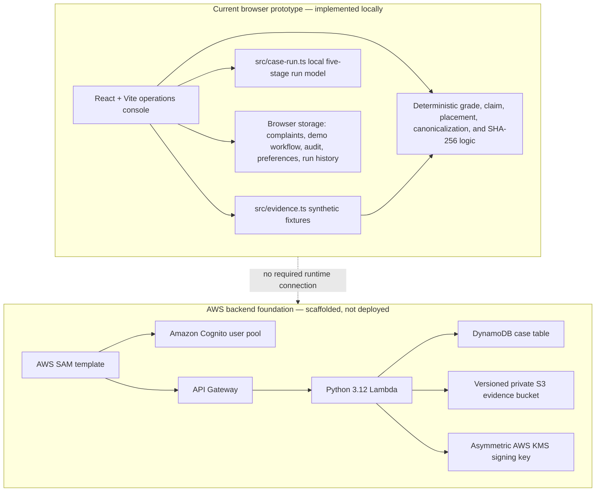

# Pramaan — Synthetic Evidence Studio

> **Investigate the evidence. Challenge the assumptions. Know what the data can—and cannot—prove.**

Pramaan is a browser-first decision-support prototype for examining **synthetic PM2.5 episodes**. It demonstrates how an investigator can compare competing explanations, expose contradictory or unavailable evidence, recommend a next measurement, validate claims against citations, and detect changes to a locally sealed evidence packet.

**Pramaan is not a pollution-monitoring service, regulatory finding, legal conclusion, medical assessment, probability-of-guilt model, or proof of causation.** The current frontend runs locally over invented fixtures and requires no AWS credentials or live sensor feeds.

[](https://www.typescriptlang.org/)
[](https://react.dev/)
[](https://vite.dev/)
[](#scientific-assumptions-and-limitations)

## At a glance

- **Audience:** hackathon judges, frontend engineers, environmental-data researchers, students, and teams exploring evidence-centric decision support.
- **Current status:** working browser prototype with local synthetic data; AWS backend foundation is scaffolded but not deployed.
- **Primary question:** what should an investigator do next when evidence is incomplete, conflicting, or suspect?
- **Design principle:** **proof before blame**—a candidate-source association is not the same as causation.

## Contents

- [Overview](#overview)
- [Why Pramaan exists](#why-pramaan-exists)
- [Core features](#core-features)
- [Demonstration scenarios](#demonstration-scenarios)
- [Investigation workflow](#investigation-workflow)
- [Architecture](#architecture)
- [Scientific assumptions and limitations](#scientific-assumptions-and-limitations)
- [Technology stack](#technology-stack)
- [Repository structure](#repository-structure)
- [Installation and local development](#installation-and-local-development)
- [Demonstration walkthrough](#demonstration-walkthrough)
- [Testing and quality assurance](#testing-and-quality-assurance)
- [Security and integrity](#security-and-integrity)
- [AWS backend foundation](#aws-backend-foundation)
- [Roadmap](#roadmap)
- [Contributing](#contributing)
- [License and acknowledgments](#license-and-acknowledgments)

## Overview

Environmental investigations often combine noisy measurements, missing records, uncertain wind conditions, sensor-quality problems, and competing explanations. A single spike near a facility does not establish that the facility caused it. Temporal coincidence and spatial proximity are useful clues, but they are not sufficient proof.

Pramaan turns that uncertainty into an inspectable demonstration workflow:

1. Load a clearly labelled synthetic case.
2. Review observations, sensor status, wind context, and alternative explanations.
3. Evaluate tests as **supports**, **contradicts**, **inconclusive**, or **unavailable**.
4. Present an illustrative grade and a concrete next action.
5. Challenge the result by perturbing wind direction and transport timing.
6. Validate claims against evidence IDs and conservative language rules.
7. Seal canonical fixture artifacts and demonstrate tamper detection.

The result is intended to support human review—not replace scientific validation, field investigation, or regulatory judgment.

## Why Pramaan exists

Pramaan explores a narrow but important question: **what should happen after a pollution complaint or suspected episode when the available evidence is not enough to support a confident attribution?**

The prototype emphasizes:

- **Refutation before attribution:** test evidence that could make a candidate less plausible.
- **Abstention as a result:** an unresolved or unassessable case should produce a next action, not a forced conclusion.
- **Explicit uncertainty:** missing, contradictory, and invalid data remain visible.
- **Candidate-specific language:** “consistent with” and “contradicted by” are intentionally narrower than “caused by.”
- **Inspectable work:** results are paired with tests, inputs, citations, configuration, and limitations.
- **Integrity awareness:** a hash can detect changed bytes, but it cannot prove that the original data was truthful.

## Core features

### Synthetic investigation cases

The app includes three reproducible fixtures designed to teach different investigation patterns:

| Case | What it demonstrates | Current synthetic result |
|---|---|---|
| **Coherent local plume** | Independent downwind rises, a stable upwind reference, and plausible wind/lag alignment | **Grade B — Consistent association** |
| **Single-sensor anomaly** | A QA-invalid reading, contrary peer evidence, and the value of refusing attribution | **Grade U — Unassessable** |
| **Regional smoke front** | Simultaneous network-wide rises that contradict a local candidate explanation | **Grade D — Contradicted** |

These are teaching fixtures. They do not establish anything about a real facility, location, sensor, or pollution event.

### Evidence evaluation

Each case exposes a falsification matrix with four explicit outcomes:

- **Supports** — the observed pattern is compatible with the hypothesis.
- **Contradicts** — the observed pattern is a credible falsifier.
- **Inconclusive** — data exists but does not discriminate between explanations.
- **Unavailable** — required data or quality information is missing.

The displayed grades and recommended actions are illustrative decision labels. They are not calibrated probabilities, statutory thresholds, health thresholds, or guilt scores.

### Interactive analysis

The browser interface includes:

- Interactive PM2.5 time-series inspection.
- Schematic sensor geometry and wind-direction display.
- Wind-direction and transport-timing cross-examination controls.
- Perturbed grade and stability behavior.
- Computed schematic next-sensor placement for the unresolved case.
- A local operations console with synthetic queue records, pending complaint intake, reports, settings, and audit-history surfaces.
- A five-stage local Run Lab: Intake, QA gate, Falsification, Cross-examination, and Seal.

Sensor coordinates are diagram positions, not GPS coordinates or field-siting instructions.

### Claim ledger

Claims are checked deterministically before the demonstration treats them as valid. The checker verifies that claims:

- Cite known sensor or test IDs.
- Include evidence rather than relying on empty citations.
- Match the fixture for displayed measurements.
- Do not use unsupported causal, legal, or health language.
- Include contrary, inconclusive, or unavailable evidence when required for an association claim.

The injected demonstration claim—“Candidate S1 caused the pollution and violated the law.”—is rejected because it uses an unknown evidence ID and unsupported causal/legal language. This is a bounded rule-based checker, not a general-purpose AI fact-checker.

### Integrity lab

The browser seals three canonical fixture artifacts:

- `observations.json`
- `assessment.json`
- `config.json`

Each receives a browser Web Crypto SHA-256 digest. The sorted digest list is hashed into a cautious **Merkle-like manifest root**. The UI can mutate a held copy of `observations.json`; verification then identifies the changed artifact and fails against the original root.

A successful hash check means that the compared bytes match the available manifest. It does **not** prove who created the data, whether a sensor was calibrated or truthful, whether the file was collected lawfully, or whether the original manifest is independently trustworthy.

### Responsive interface

The current UI is a dark editorial operations console with layered depth, orbit/grid motifs, evidence panels, responsive layouts, visible keyboard focus, reduced-motion handling, print-oriented report styling, and explicit local/synthetic/pending boundaries.

## Demonstration scenarios

### 1. Coherent local plume

Two independent downwind monitors rise in sequence while the upwind reference remains near baseline. Wind direction and transport timing are compatible with the candidate hypothesis, but another local source is not fully excluded. The fixture therefore presents a **Grade B association**, not causation.

### 2. Single-sensor anomaly

Monitor D1 reports an extreme plateau, but its clock is shifted and its calibration is expired. Independent peer monitors do not corroborate the rise. The result is **Grade U — Unassessable**, with a recommendation to inspect D1, restore calibration, and place an independent monitor at a computed schematic location.

### 3. Regional smoke front

Upwind and regional references rise at the same time as downwind monitors. That simultaneous pattern contradicts the local candidate-source hypothesis and better fits a regional event. The result is **Grade D — Contradicted** for that candidate and window; it is not proof that no local contribution was possible under every other condition.

## Investigation workflow

```mermaid
flowchart LR
    A[Select synthetic case] --> B[Inspect observations and QA]
    B --> C[Review chart and schematic geometry]
    C --> D[Evaluate supports / contradicts / inconclusive / unavailable]
    D --> E[Read grade and next action]
    E --> F[Challenge wind and transport timing]
    F --> G[Review uncertainty and next-sensor placement]
    G --> H[Validate citation-enforced claims]
    H --> I[Seal canonical artifacts]
    I --> J[Toggle tampering and verify]
```



### What each stage does

1. **Select:** choose one of the three deterministic synthetic fixtures.
2. **Inspect:** review PM2.5 values, coverage, baseline, sensor status, and the analysis window.
3. **Compare:** examine time-series behavior and the schematic arrangement of upwind/downwind monitors.
4. **Test:** read the explicit falsification outcomes and their fixture-specific explanations.
5. **Decide:** interpret the illustrative grade together with the recommended next action.
6. **Challenge:** shift wind and timing assumptions; the prototype reports a stability index and perturbed grade without claiming a calibrated posterior.
7. **Plan:** inspect the schematic next-sensor placement where the case is unresolved.
8. **Audit language:** inject an unsupported claim and observe deterministic rejection.
9. **Seal:** calculate canonical SHA-256 artifact digests and a sorted manifest root.
10. **Verify:** mutate `observations.json`, observe failure, then restore the original state and verify again.

## Architecture

### Current browser prototype



The frontend currently runs from local fixtures and browser storage. The AWS resources are defined in `infrastructure/template.yaml` but are not provisioned by this repository.

### Important implementation files

- [`src/evidence.ts`](src/evidence.ts) — three case fixtures, outcomes, grade behavior, sensitivity calculations, schematic placement, claim validation, canonicalization, sealing, and verification.
- [`src/main.tsx`](src/main.tsx) — React application, operations console, investigation views, Run Lab, local workflow surfaces, exports, and settings.
- [`src/style.css`](src/style.css) — dark editorial visual system, responsive layout, accessibility states, print styles, and local-boundary treatments.
- [`src/case-run.ts`](src/case-run.ts) — deterministic local five-stage case-run model and packet history behavior.
- [`src/service.ts`](src/service.ts) — optional API configuration and explicit local fallback behavior.
- [`src/operations-analytics.ts`](src/operations-analytics.ts) — deterministic local queue/report analytics.
- [`backend/src/handler.py`](backend/src/handler.py) — small Python Lambda API foundation with mock mode, validation, idempotent case creation, DynamoDB access, and S3 metadata writes.
- [`infrastructure/template.yaml`](infrastructure/template.yaml) — AWS SAM scaffold for Cognito, API Gateway, Lambda, DynamoDB, S3, and KMS.

### Documentation architecture

- [`docs/PRAMAAN_MASTER_SPEC.md`](docs/PRAMAAN_MASTER_SPEC.md) — product, scientific, UX, integrity, ethics, AWS, and acceptance specification.
- [`docs/PROJECT_BLUEPRINT.md`](docs/PROJECT_BLUEPRINT.md) — domain model, falsification approach, target architecture, and validation plan.
- [`docs/PHASES.md`](docs/PHASES.md) — delivery phases and exit gates.
- [`docs/BUILD_LOG.md`](docs/BUILD_LOG.md) — implementation history, verified checks, and explicit boundaries.
- [`docs/REAL_WORLD_INTEGRATION.md`](docs/REAL_WORLD_INTEGRATION.md) — validation-only contracts and boundaries for future real-world integration.
- [`backend/README.md`](backend/README.md) — backend mock mode, SAM commands, routes, and deployment cautions.

## Scientific assumptions and limitations

All observations, timestamps, sites, source labels, scores, advisory events, and sensor values in the fixtures are invented.

The prototype currently demonstrates:

- A structured comparison of candidate-source hypotheses.
- Explicit treatment of supporting, contradictory, inconclusive, unavailable, and invalid evidence.
- Deterministic example grade labels and next-action recommendations.
- Sensitivity behavior for declared wind and timing perturbations.
- Schematic placement geometry based on a wind-from bearing.
- Evidence-linked claim validation and local byte-change detection.

The prototype does **not** provide:

- Real sensor ingestion, calibration, or field measurements.
- A validated atmospheric-dispersion model.
- Calibrated posterior probabilities or error rates.
- A regulatory threshold or legal determination.
- Health or safety advice.
- Proof that a candidate caused an episode.
- A georeferenced sensor deployment recommendation.
- A trusted chain of custody, timestamp authority, signature, or immutable evidence store.
- Independent scientific review of the fixture rules.

The synthetic **Grade B** result means only that the coded fixture is consistent with the displayed candidate hypothesis under its example rules. The **Grade U** result demonstrates refusal to assess when QA is invalid. The **Grade D** result is a candidate-specific contradiction for a defined episode window; it is not universal exoneration.

Before real-world use, the project would require independent domain review, real sensor and weather contracts, calibration and placement metadata, missing-data and uncertainty analysis, field validation, privacy controls, reproducibility checks, and a reviewed claims policy.

## Technology stack

### Active browser application

- React 18 and React DOM.
- TypeScript 5.7.
- Vite 6.
- CSS, including responsive and print styles.
- `lucide-react` for interface icons.
- `@fontsource/dm-sans` and `@fontsource/space-grotesk` for typography.
- Browser Web Crypto API for SHA-256 verification.
- Browser `localStorage` for best-effort local workflow, audit, preference, and run-history state.

### Backend foundation

The backend is separate from the quick-start frontend and is not deployed. The scaffold uses:

- AWS SAM / CloudFormation.
- Python 3.12 Lambda runtime and boto3 supplied by the AWS runtime.
- Amazon Cognito user pool and client.
- API Gateway.
- DynamoDB with point-in-time recovery and server-side encryption enabled in the template.
- Versioned, private S3 evidence storage with optional Object Lock at bucket creation.
- An asymmetric AWS KMS signing key defined in the template.

These AWS technologies are infrastructure definitions or backend scaffolding, not active services in the default browser run.

## Repository structure

```text
.
├── README.md
├── package.json
├── package-lock.json
├── index.html
├── tsconfig.json
├── src/
│   ├── evidence.ts              # fixtures and deterministic evidence logic
│   ├── main.tsx                 # React application and console views
│   ├── style.css                # responsive visual system
│   ├── case-run.ts              # local five-stage run model
│   ├── run-lab.tsx              # Run Lab interface
│   ├── complaint-workspace.tsx  # local complaint intake
│   ├── demo-workspace.ts        # seeded local workflow records
│   ├── operations-analytics.ts  # local deterministic reports
│   ├── console-helpers.ts       # local parsing and workflow helpers
│   ├── service.ts               # optional backend boundary
│   └── geo.ts                   # coordinate model and map boundary
├── docs/
│   ├── PRAMAAN_MASTER_SPEC.md
│   ├── PROJECT_BLUEPRINT.md
│   ├── PHASES.md
│   ├── BUILD_LOG.md
│   └── REAL_WORLD_INTEGRATION.md
├── backend/
│   ├── README.md
│   ├── requirements.txt
│   └── src/handler.py
├── infrastructure/
│   └── template.yaml
├── reports/
└── samconfig.toml.example
```

A new contributor should start with `src/evidence.ts`, then `src/main.tsx`, followed by `docs/PRAMAAN_MASTER_SPEC.md` and `docs/BUILD_LOG.md`.

## Installation and local development

### Prerequisites

The repository does not declare an exact Node.js or npm version. Use a currently supported Node.js installation compatible with the versions declared in `package.json`.

### Clone and install

```bash
git clone https://github.com/Rishigit222/pramaan.git
cd pramaan
npm install
```

### Start the frontend

```bash
npm run dev
```

Vite prints the local URL in the terminal, normally on a localhost port. No AWS account, API key, backend, or live data source is required for the browser prototype.

### Production build and preview

```bash
npm run build
npm run preview
```

`npm run build` runs `tsc -b` followed by `vite build`. `npm run preview` serves the generated production build locally.

### Troubleshooting

- **Dependency installation fails:** confirm that Node.js and npm are supported and retry after removing an incomplete `node_modules` directory and lockfile changes made locally.
- **Port already in use:** stop the other process or start Vite with an alternate port, for example `npm run dev -- --port 5174`.
- **Hash verification is unavailable:** run the app in a secure browser context such as the Vite localhost server. The prototype depends on browser Web Crypto support.
- **You expected AWS requests:** the default app is local-first. Configure the optional service boundary only after reviewing [`src/service.ts`](src/service.ts), [`backend/README.md`](backend/README.md), and the undeployed template.

## Demonstration walkthrough

### Scenario A — Coherent local plume

1. Open **Investigations** and select **Coherent local plume**.
2. Compare the D1 and D2 downwind rises with the stable U1 reference.
3. Review the supporting wind/lag and spatial-coherence outcomes.
4. Read **Grade B — Consistent association** and its bounded next action.
5. Move the wind and timing controls far enough to weaken alignment; the coded sensitivity function caps this fixture at **Grade C** when stability falls below its threshold.
6. Keep the language at “consistent with.” The synthetic result is not proof of causation.

### Scenario B — Single-sensor anomaly

1. Select **Single-sensor anomaly**.
2. Inspect D1’s repeated 83 µg/m³ plateau, clock skew, and expired calibration.
3. Compare D1 with the stable independent peer and upwind reference.
4. Observe **Grade U — Unassessable**.
5. Review the computed schematic next-sensor placement and the recommendation to repair QA before attribution.

The important behavior is abstention: additional trustworthy measurements are more useful than forcing a source conclusion from an invalid reading.

### Scenario C — Regional smoke front

1. Select **Regional smoke front**.
2. Compare simultaneous rises at upwind, downwind, and regional references.
3. Review the candidate-specific contradiction and regional-smoke alternative.
4. Observe **Grade D — Contradicted** for the defined candidate and window.

This does not prove that no local source contributed under any other conditions; it shows why a local candidate does not explain this synthetic pattern well.

### Scenario D — Claim ledger

1. Open the case’s **Evidence** view.
2. Inject the unsupported claim.
3. Observe rejection for the unknown citation and causal/legal overclaim.
4. Remove the injected claim and confirm that the fixture’s valid claim set passes again.

### Scenario E — Integrity lab

1. Seal the selected case.
2. Toggle tampering.
3. Observe a failed verification and the changed `observations.json` artifact.
4. Toggle tampering off and verify the original manifest again.

## Testing and quality assurance

The current `package.json` exposes these scripts:

| Command | Purpose |
|---|---|
| `npm run dev` | Start the Vite development server. |
| `npm run build` | Run TypeScript project build and production Vite compilation. |
| `npm run preview` | Serve the production build locally. |

There is currently **no test script or configured automated browser test runner** in `package.json`. The implementation history records repeated build checks and manual demonstration checks for fixture loading, claim rejection, sealing, tamper detection, responsive behavior, and local workflow boundaries in [`docs/BUILD_LOG.md`](docs/BUILD_LOG.md).

Known QA gaps include automated UI interaction coverage, scientific validation, real-data evaluation, calibration studies, field siting validation, and deployed-service verification. Do not interpret a successful frontend build as evidence that the scientific method is validated.

## Security and integrity

### Demonstrated now

- Canonicalized local fixture artifacts.
- Browser SHA-256 hashing through Web Crypto.
- Sorted digest-list hashing into a Merkle-like manifest root.
- Deterministic claim and citation checks.
- Visible detection of a changed observation artifact.
- Explicit local-only status for browser storage, audit events, and downloaded packets.

### Not provided by the current prototype

- Trusted timestamping.
- Independent digital signatures.
- Immutable or permanent evidence storage.
- Sensor authenticity, calibration truth, or lawful collection proof.
- Production authentication and authorization in the browser-only path.
- A validated chain of custody.
- A deployed cloud audit service.

The future AWS scaffold defines stronger building blocks, but a resource in a template is not an active security control until it is deliberately deployed, configured, reviewed, monitored, and operated.

## AWS backend foundation

> **Status: scaffold only; not deployed.** The browser prototype remains the primary quick-start path.

The backend uses AWS SAM to describe a possible `us-east-1`-oriented deployment. The template defines:

- Cognito user pool and public client.
- API Gateway with a Cognito authorizer.
- Python 3.12 Lambda function.
- DynamoDB case table with on-demand billing, point-in-time recovery, and server-side encryption.
- Private versioned S3 evidence bucket with public-access blocking and optional Object Lock.
- Asymmetric KMS signing key and alias.

The current Python handler implements these routes:

| Method | Route | Current foundation behavior |
|---|---|---|
| `POST` | `/cases` | Validate and create a case record. |
| `GET` | `/cases` | List up to 50 cases. |
| `GET` | `/cases/{caseId}` | Retrieve one case. |
| `POST` | `/complaints` | Validate and create a complaint record. |
| `GET` | `/cases/{caseId}/verification` | Return the current foundation verification status. |

`MOCK_MODE=true` keeps local backend exercises credential-free using process-local storage. That storage is not evidence-grade persistence.

### Backend commands

The backend README documents this PowerShell mock-mode example:

```powershell
$env:MOCK_MODE='true'; python -c "import sys; sys.path.insert(0,'backend'); from src.handler import lambda_handler; print(lambda_handler({'httpMethod':'POST','path':'/complaints','headers':{'Idempotency-Key':'demo-1'},'body':'{\"incidentType\":\"smoke\",\"occurredAt\":\"2026-06-18T10:00:00Z\",\"location\":\"synthetic\"}'} , None))"
```

For an intentional AWS deployment review, the documented commands are:

```powershell
sam validate --template-file infrastructure/template.yaml
sam build --template-file infrastructure/template.yaml
sam deploy --guided --template-file infrastructure/template.yaml --region us-east-1
```

Deployment requires an AWS account, credentials, CloudFormation/SAM permissions, IAM role-creation permission, a reviewed CORS origin, and deliberate configuration of storage retention and signing policies.

Object Lock deserves particular care: the template notes that it must be chosen when the bucket is created and cannot simply be added later. Retention periods, legal holds, deletion behavior, break-glass access, key policy, and operational ownership must be reviewed before enabling it.

The Open-Meteo and OpenAQ adapters are contracts or metadata-only boundaries, not live feed integrations in the default app. No live endpoint, account ID, credential, deployment, calibration result, or real-world measurement is included here.

## Roadmap

### Implemented in the prototype

- Three synthetic PM2.5 investigation cases.
- Explicit falsification outcomes and illustrative grades.
- Interactive chart and schematic sensor map.
- Wind/timing cross-examination and sensitivity behavior.
- Schematic next-sensor placement.
- Deterministic claim ledger with unsupported-claim rejection.
- Browser SHA-256 sealing and tamper verification.
- Local operations console, complaint intake boundary, Run Lab, local analytics, exports, audit history, and responsive UI.

### Scaffolded or partially implemented

- Python Lambda handler and local mock mode.
- AWS SAM template for Cognito, API Gateway, Lambda, DynamoDB, S3, and KMS.
- Optional frontend service configuration and local fallback.
- Validation-only contracts for future real-world integrations.
- Backend routes and storage metadata behavior without a deployed environment.

### Planned future work

- Validated real-data ingestion and quality-control pipelines.
- Calibration, placement, uncertainty, and meteorological contracts.
- Independent scientific evaluation and grade calibration.
- Stronger provenance, signing, verification, and audit workflows.
- Reviewed immutable storage and retention controls.
- Reviewer authentication and approval workflows.
- Field-validated sensor placement.
- Automated unit, scenario, property, browser, and end-to-end tests.
- Privacy-preserving public views and right-of-reply workflows.

No roadmap item should be read as complete merely because it appears in the blueprint or infrastructure template.

## Contributing

1. Read [`docs/PRAMAAN_MASTER_SPEC.md`](docs/PRAMAAN_MASTER_SPEC.md) and [`docs/PHASES.md`](docs/PHASES.md) before changing evidence behavior.
2. Install dependencies with `npm install`.
3. Run `npm run build` before submitting a frontend change.
4. Keep synthetic, local, pending, scaffolded, and deployed states visibly distinct.
5. Update [`docs/BUILD_LOG.md`](docs/BUILD_LOG.md) with checks that were actually run.
6. Update this README when the run flow, supported routes, scientific claims, or implementation boundaries change.
7. For bugs, include the browser/runtime, reproduction steps, selected case, expected behavior, actual behavior, and relevant console output. Do not include credentials or sensitive complaint information.
8. Document any scientific assumption, grade rule, integrity property, or security claim alongside its limitation.

## License and acknowledgments

No license file is currently present in the repository. Until a license is added, the project should not be assumed to grant permissions beyond the rights provided by applicable law.

The application uses open-source React, Vite, TypeScript, Lucide React, and Fontsource packages listed in [`package.json`](package.json). Refer to each dependency’s own license and repository for attribution details.

---

**Pramaan is a demonstration of disciplined investigation—not an automated accusation engine.**
